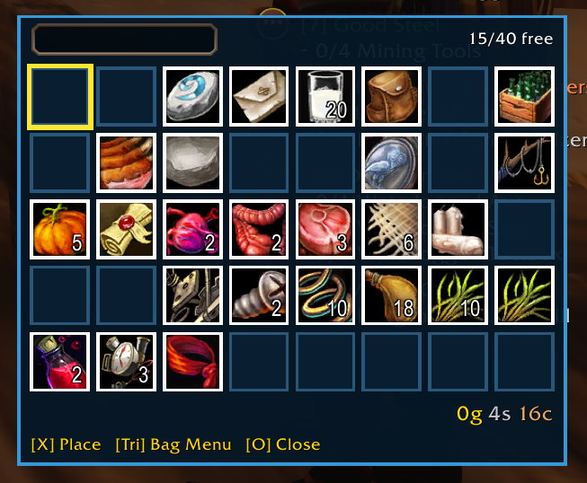

# Aquifer

One grid bag for **WoW: Forever** (client folder `_forever_`). All your bags show in a single window, and you can move through it with a PlayStation or Xbox controller d-pad.

- All bags in one grid, with a water-blue look.
- Controller d-pad moves one slot per press, in the direction you press.
- Item menu and bag menu on the controller.
- Search box: items that don't match are greyed out.
- Shows free slots, your money, and item cooldowns.
- Minimap button to open the bag and change settings.

## Install

1. Download this repo (green **Code** button → **Download ZIP**).
2. Unzip it and rename the folder to `Aquifer`.
3. Put it in `World of Warcraft/_forever_/Interface/AddOns/`.
4. Restart the game, or type `/reload`.

## Controller buttons

Labels are PlayStation first, Xbox in brackets.

| Button | On an item | On an empty slot |
|---|---|---|
| **D-pad** | Move the yellow frame one slot | Move the yellow frame one slot |
| **X** (A) / **Triangle** (Y) | Item menu: Use, Equip, Bind, Split, Share in Chat, Destroy (only what fits the item) | Bag menu: Cleanup, Sell Junk, Hide empty slots |
| **Square** (X) | Quick action: Equip if it is gear, otherwise Use (the footer shows which) | Nothing |
| **Circle** (B) | Close the menu, then the bag | Close the menu, then the bag |

Turn controller movement off with `/aq pad off` or the **Controller d-pad in bag** checkbox.

### Bind an item to an action bar

WoW only allows **Bind to Action Bar** from Blizzard's own bags, so Aquifer hands this step over to them.

1. Outside combat, choose **Bind** in the item menu. Aquifer closes and lets go of the controller.
2. Press your **Bags** button yourself. The hint shows the key you have set. Blizzard's bag opens.
3. Select the named item, then choose **More Actions → Bind to Action Bar**.
4. Pick the action bar and press the button you want to bind it to.
5. Close Blizzard's bags and dialog, then type **`/aq bindcancel`** to return to Aquifer. In combat, the return waits until combat ends.

## Mouse

| Action | What it does |
|---|---|
| Left click a slot | Pick up the item, or drop it into a slot |
| Right click an item | Use it |
| **Alt** + left-drag the window | Move the window (out of combat). The position is saved. |

## Minimap button

The button sits on the outer edge of the minimap.

| Action | What it does |
|---|---|
| Left click | Open or close the bag |
| Right click | Open the settings window |
| Drag | Slide the button around the edge of the minimap (the spot is saved) |
| Hover | Shows what the button does |

Hide it with `/aq minimap off` or the **Hide minimap icon** checkbox.

## Commands

Every command works with `/aquifer` or the short `/aq`.

| Command | What it does |
|---|---|
| `/aq help` | List the commands in chat |
| `/aq toggle` | Open or close the bag |
| `/aq settings` | Open the settings window |
| `/aq search word` | Grey out every item that doesn't match (empty text clears it) |
| `/aq cols 8` | Slots per row (4 to 20, default 8) |
| `/aq scale 1` | Window size (0.5 to 2, default 1) |
| `/aq hide on` / `off` | Hide empty slots |
| `/aq pad on` / `off` | Turn controller d-pad movement on or off |
| `/aq minimap on` / `off` | Show or hide the minimap button |
| `/aq default on` / `off` | `off` uses Aquifer; `on` brings the normal bags back |
| `/aq reset` | Put the window back at its starting spot |
| `/aq config` | Show your current settings in chat |
| `/aq bindcancel` | Return to Aquifer after a Bind handoff |

## Settings window

Open it with `/aq settings` or right-click the minimap button.

- **Hide minimap icon**
- **Controller d-pad in bag**
- **Use Aquifer instead of normal bag**
- **Hide empty slots**
- **Columns** `+` / `-` to change slots per row

## Search and money

- **Search:** type in the box at the top of the window. Items that don't match are greyed out. Press Escape to clear it.
- **Money:** your gold, silver and copper show at the bottom of the window.

## License

See [LICENSE](LICENSE).

Author: Audrey
