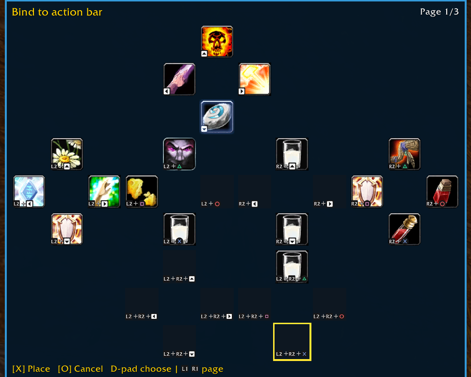

# Aquifer

One grid bag for **WoW: Forever** (client folder `_forever_`). All your bags show in a single window, and you can move through it with a PlayStation or Xbox controller d-pad.

- All bags in one grid, with a water-blue look.
- Controller d-pad moves one slot per press, in the direction you press.
- Item menu and bag menu on the controller.
- Search box: items that don't match are greyed out.
- Shows free slots, your money, and item cooldowns.
- Minimap button to open the bag and change settings.
- Saved bank contents, including other characters on this account.
- L2/R2 switches between the bag and open bank, vendor, trade, and other stock windows.

## Install

1. Download this repo (green **Code** button → **Download ZIP**).
2. Unzip it and rename the folder to `Aquifer`.
3. Put it in `World of Warcraft/_forever_/Interface/AddOns/`.
4. Restart the game, or type `/reload`.

## Controller buttons

Labels are PlayStation first, Xbox in brackets.

| Button | On an item | On an empty slot |
|---|---|---|
| **D-pad** | Move the yellow frame one slot | Move the yellow frame one slot |
| **X** (A) / **Triangle** (Y) | Item menu: Use, Equip, Bind, Split, Share in Chat, Destroy (only what fits the item) | Bag menu: Cleanup, Sell Junk, Hide empty slots, View bank |
| **Square** (X) | Quick action: Equip if it is gear, otherwise Use (the footer shows which) | Nothing |
| **Circle** (B) | Close the menu, then the bag | Close the menu, then the bag |

Turn controller movement off with `/aq pad off` or the **Controller d-pad in bag** checkbox.

### Move items between windows

With Aquifer and another window open, **L2/R2** (LT/RT) moves focus left/right between them. Your held item stays on the cursor. The d-pad controls the window that has focus.

In Aquifer, **X** (A) changes with the open window:

| Open window | X (A) on an item |
|---|---|
| Vendor | Sell the item (not on the buyback tab or in repair mode) |
| Bank | Deposit |
| Trade | Trade |
| Send Mail | Attach |
| Mail inbox, auction, guild bank | Pick up the item for manual placement |

To choose a particular destination slot at a bank, vendor or trade window, use **Triangle → Pick up**, then **L2/R2** to the other window and **X** to place it. To bring an item back, pick it up in the stock window, switch to Aquifer, and press **X** on a bag slot. While holding an item, X places it rather than selling or using another item. Away from these windows, X still opens the normal item menu.

### Bind an item to an action bar

WoW only allows **Bind to Action Bar** from Blizzard's own bags, so Aquifer hands this step over to them.

1. Outside combat, choose **Bind** in the item menu. Aquifer closes and lets go of the controller.
2. Press your **Bags** button yourself. The hint shows the key you have set. Blizzard's bag opens.
3. Select the named item, then choose **More Actions → Bind to Action Bar**.
4. Pick the action bar and press the button you want to bind it to.
5. Close Blizzard's bags and dialog, then type **`/aq bindcancel`** to return to Aquifer. In combat, the return waits until combat ends.

## Mouse

| Action | What it does |
|---|---|
| Left click a slot | Pick up the item, or drop it into a slot |
| Right click an item | Use it |
| **Alt** + left-drag the window | Move the window (out of combat). The position is saved. |

## Minimap button

The button sits on the outer edge of the minimap.

| Action | What it does |
|---|---|
| Left click | Open or close the bag |
| Right click | Open the settings window |
| Drag | Slide the button around the edge of the minimap (the spot is saved) |
| Hover | Shows what the button does |

Hide it with `/aq minimap off` or the **Hide minimap icon** checkbox.

## Commands

Every command works with `/aquifer` or the short `/aq`.

| Command | What it does |
|---|---|
| `/aq help` | List the commands in chat |
| `/aq toggle` | Open or close the bag |
| `/aq settings` | Open the settings window |
| `/aq bank` or `/aqb` | Open or close saved Bank memory |
| `/aq search word` | Grey out every item that doesn't match (empty text clears it) |
| `/aq cols 8` | Slots per row (4 to 20, default 8) |
| `/aq scale 1` | Window size (0.5 to 2, default 1) |
| `/aq hide on` / `off` | Hide empty slots |
| `/aq pad on` / `off` | Turn controller d-pad movement on or off |
| `/aq minimap on` / `off` | Show or hide the minimap button |
| `/aq default on` / `off` | `off` uses Aquifer; `on` brings the normal bags back |
| `/aq reset` | Put the window back at its starting spot |
| `/aq config` | Show your current settings in chat |
| `/aq bindcancel` | Return to Aquifer after a Bind handoff |

## Settings window

Open it with `/aq settings` or right-click the minimap button.

- **Hide minimap icon**
- **Controller d-pad in bag**
- **Use Aquifer instead of normal bag**
- **Hide empty slots**
- **Columns** `+` / `-` to change slots per row

## Search and money

- **Search:** type in the box at the top of the window. Items that don't match are greyed out. Press Escape to clear it.
- **Money:** your gold, silver and copper show at the bottom of the window.

## Bank memory

Visit your bank once to save its contents. Aquifer remembers the main bank, your bank bags, and reagent storage when available. The saved view updates while the real bank is open.

Open **Bank** anywhere with **`/aq bank`**, **`/aqb`**, or **Triangle on an empty bag slot → View bank**. This is a separate window. It shows the last saved items, free slots, and a **Snapshot** date and time.

- Type in the search box to grey out items that do not match.
- Hover an item, or select it with the d-pad, to see its tooltip.
- The d-pad moves through the grid and onto the next page. The `<` and `>` buttons also change pages.
- **Next character** cycles through banks you have saved on this account, with realm names shown.
- **Circle** or the top-right **X** closes the window. **Alt + drag** moves it.

Bank memory is **read only**: clicking an item cannot use, move, sell or trade it. It shows the last saved visit, not live contents while you are away. Opening it closes Aquifer's live bag; opening the live bag closes memory. Memory cannot open in combat and closes when combat starts.

## License

See [LICENSE](LICENSE).

Author: Audrey

## Window focus and recovery (2.2.1)

Use the stock **L2/R2** (LT/RT) controls to switch windows. Aquifer remembers its
selected bag slot, follows the same item ID when it moves where possible, and
clamps to a valid slot when that item disappears. Identical item stacks may select
a matching stack. Stock windows keep their native selection rules.

The existing footer shows **Cross / X on PlayStation, A on Xbox (PAD1)** for
**Sell item**, **Deposit**, **Attach** or **Trade**, according to the open window.
Hovering an item selects it while Aquifer owns the controls, outside combat.
Items with no sell value show **Can't sell**; an unknown price hides the sale hint.

The focus notice is hidden by default. `/aq notice` toggles it for debugging.
There is no recovery button. Use `/aq recover` to close Aquifer's menus and restore
its selection without clearing a held item or changing stock windows. Recovery
requested during combat waits silently until combat ends. Aquifer's d-pad and
face-button overrides pause during combat, then follow the current window again.

After **Bind**, use your normal Bags button and complete the action in the stock
bags. Close the stock bags and binding dialog, then use `/aq bindcancel` to return.
This never presses Bind or reopens bags while the stock binding UI is active.

Native controller focus and taint still need an in-game check; the offline tests
exercise the exported stock focus manager and the contextual action guards.
